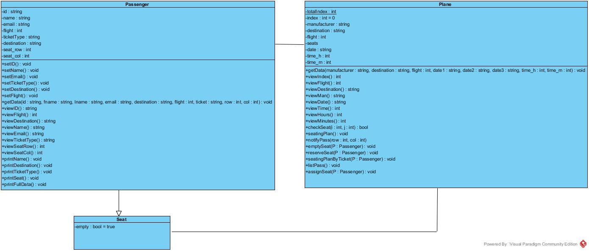

# Airplane Flights Reservation

A C++ console application for managing airplane flight reservations: registering and editing passengers, assigning seats by ticket class, adding and cancelling flights, and searching flights by number or departure time. All data is kept in plain-text files between runs.

This was the team project for **CSE228: Advanced Computer Programming** at the Faculty of Engineering, Ain Shams University (summer 2017), submitted to Dr. Abdelaziz A. Abdel Hamid on 17 August 2017. The code is preserved as submitted; see [Known limitations](#known-limitations) for what a 2017 student project does and doesn't do.

## Team

- Philopatear Salib
- Riad Mohamed Abdullah
- Ossama Rizq
- Nourhan Ayman

## The brief

The course asked groups of up to four to build a management system with full CRUD (create, read, update, delete) on its main objects, using object-oriented design, dynamic arrays or the STL, and file handling. Our team took the **Flights** topic. The original brief is in [`docs/project-brief.pdf`](docs/project-brief.pdf) and the submitted report, with a user manual and error-code table, is in [`docs/report.pdf`](docs/report.pdf).

## Features

The program opens to a 12-option menu:

| # | Option | | # | Option |
|---|---|---|---|---|
| 1 | Register new passenger | | 7 | List passengers of a flight |
| 2 | Edit passenger data | | 8 | List all passengers on all flights |
| 3 | Search for a passenger | | 9 | Search for a flight |
| 4 | Cancel a reservation | | 10 | Search flights in a time interval |
| 5 | Register new flight | | 11 | Cancel a flight |
| 6 | Edit flight data | | 12 | Save and exit |

Each plane has a 13 × 6 seat grid split into First (rows 0–1), Business (rows 3–6) and Economy (rows 8–12). When booking, the program shows only the seats in the passenger's class, marking free seats `*` and taken seats `X`. Errors such as an unknown passenger ID, a duplicate flight number or an invalid menu choice are reported with numbered error codes, listed in the report.

## Design

Three classes, shown in [`docs/class-diagram.jpg`](docs/class-diagram.jpg) (Visual Paradigm source in `docs/class-diagram.vpp`):

- **`Passenger`** holds ID, name, email, destination, flight number, ticket class and seat.
- **`Seat`** extends `Passenger` with an occupied flag, so each seat stores the details of whoever booked it.
- **`Plane`** holds manufacturer, destination, flight number, departure date and time, and its seat grid. It handles seat reservation, release, seat-map display and passenger listing.

Planes and passengers are loaded from `Planes.txt` and `Passengers.txt` into dynamically allocated arrays at startup, which grow and shrink as records are added or removed.



## Screenshots

`docs/screenshots/` has a folder for each menu option, numbered to match the menu (`01` = register a passenger, `02` = edit a passenger, and so on). The screenshots were taken during testing and show an earlier wording of some menu labels ("Plane" rather than "Flight"). Names, emails and student IDs typed into them during testing have been blanked out.

## Building and running

**Visual Studio:** open `Airport Project.sln` (originally built with Visual Studio 2015, toolset v140; newer versions will offer to retarget) and run.

**g++ / clang:** from the `Airport Project` folder:

```bash
g++ -std=c++17 Source.cpp -o flights
./flights
```

Run it from the folder containing `Planes.txt` and `Passengers.txt`. The repo ships with the team's 41 test flights and six invented sample passengers. The program rewrites both files when you choose option 12, so keep a copy if you want to reset them.

## Repository layout

```
Airport Project.sln          Visual Studio solution
Airport Project/             final submitted source (Header.h, Source.cpp) and data files
docs/                        brief, report, class diagram, screenshots
history/
  2017-08-07-prototype/      first working version: one booking per run
  2017-08-13-intermediate/   Source.cpp midway to the final version (its matching header wasn't kept)
```

The `history/` folder shows how the program grew from a single-booking prototype into the full CRUD system over about ten days.

## Known limitations

- **No GUI.** The brief listed GUI as a required skill; the team delivered a console application, as the report notes.
- **Saving happens only on exit.** Changes are written back to the text files only when you choose option 12. Closing the window any other way loses that session's changes.
- **Little input validation.** Typing letters where a number is expected (a flight number, a seat row) puts the console input stream into a failed state.
- **Two functions can fall off the end without returning a value** (`cancelReservation` and `cancelFlight`), which compilers flag as a warning and is undefined behaviour in C++.
- **Seat fields are cleared by assigning `NULL` to integers**, another compiler warning.
- **Original g++ build error, fixed after the archive tag.** The submitted `Header.h` mentions `Plane` before declaring it, which MSVC accepted but g++ rejects. A one-line forward declaration fixes it; the untouched submission is tagged `v2017-original`.

## Reference

Lafore, R. (2002). *Object-Oriented Programming in C++*. Sams Publishing.
